# Agent Buddy

A super light app for managing all your LLM AI tools.

- **Plan limits at a glance:** Claude (its week, and each model's share of it), ChatGPT's Codex and Copilot: how much is used and when each resets, in a floating panel and the menu bar.
- **Job reminders:** a notification or an on-screen card when an agent finishes, with its last words.
- **Agent windows:** every prompt of a session with its answer and steps, LaTeX formulas typeset, and a summary of the changes it made, on frosted glass. Search them, keep several as tabs of one window, and ask more, even while the agent works, taking along the words you've selected in Zed, Safari, Chrome, VS Code and other apps. Open the session here in Agent Buddy, or jump to where it's open; lights show where it's open and how well it's reached.
- **Token usage statistics:** today, 7 days and 30 days, by agent, model, server and job.
- **Remote server management:** agents you run on your servers over SSH are followed too.
- **Stay awake:** the Mac stays awake while agents work, until they're done.

Works with Claude Code, Codex, GitHub Copilot, DeepSeek Harness, Gemini CLI, OpenCode, Qwen Code and Cursor's agent CLI ([what each supports](#agents-it-supports)).

## A quick tour

Drawn from made-up sample jobs. Each folder under [`docs/tour`](docs/tour) has its pictures with the steps.

### Always in control of how much token is left, and when it resets ([more](docs/tour/1-usage/README.md))

**Included:** the floating panel, every limit with its reset time (on Ultra, Claude's week and Fable's share of it), everyone's next Codex reset, and finished jobs.<br>
**Here we show how to:** read your limits at a glance, open the details, and find the jobs that finished.

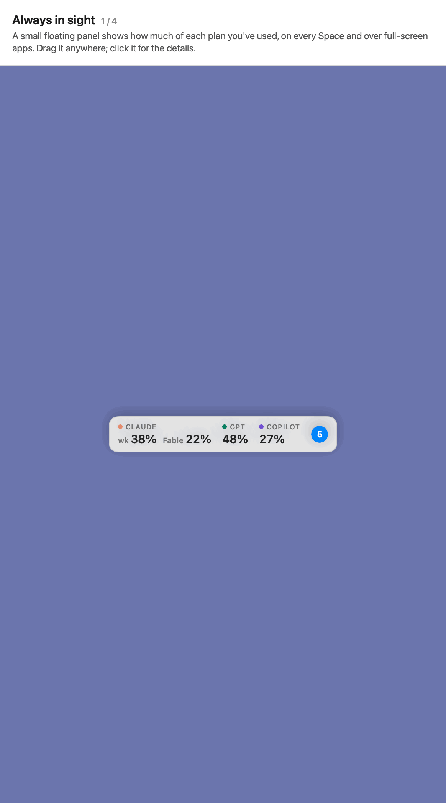

### Control all your agents in one place ([more](docs/tour/2-agent-windows/README.md))

**Included:** the list of agent windows, and a window's prompts, answers and tokens.<br>
**Here we show how to:** open an agent window from a finished job or the list.

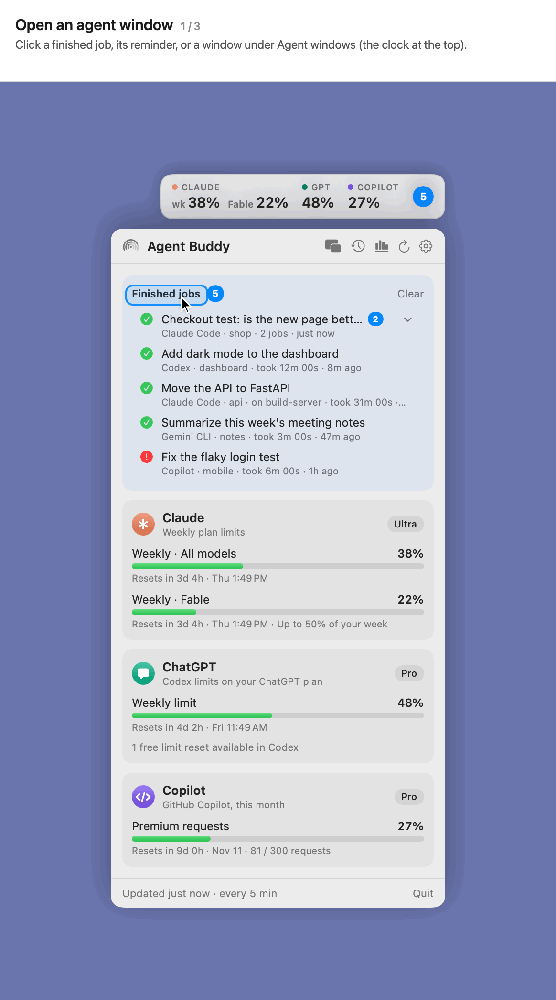

**Included:** latex formulas support, tables, code boxes, every step the agent took, and the change summary.<br>
**Here we show how to:** read an answer, open a step for what it printed, and see every change the agent made.

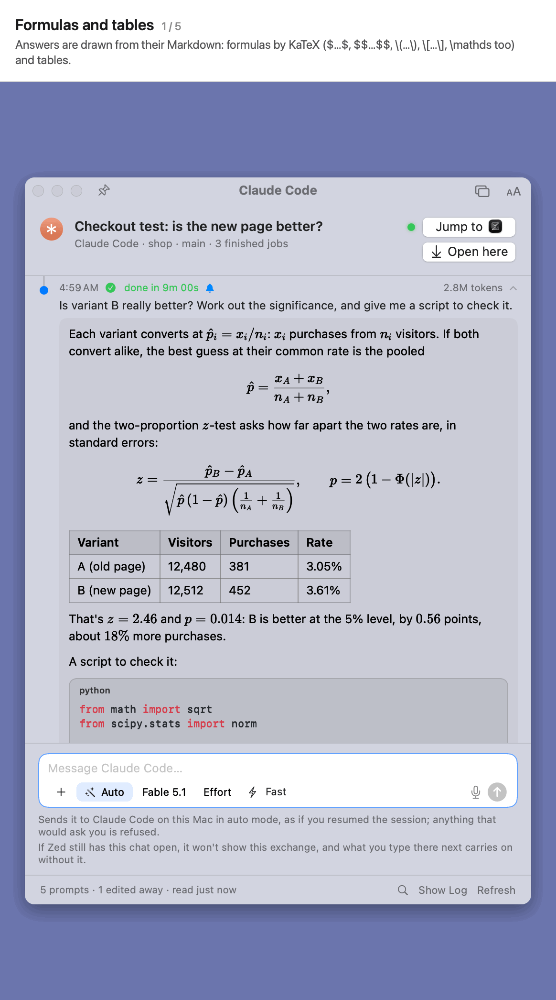

**Included:** Jump to and Open here with their lights, a server's signal, Let go, and windows as tabs.<br>
**Here we show how to:** go straight to where a session runs, open it in Agent Buddy, see how well it's reached, and keep several windows as tabs.

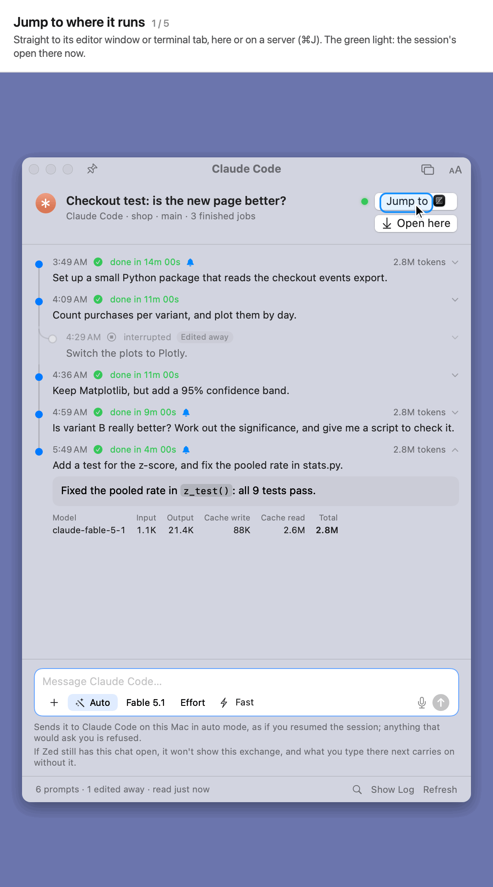

**Included:** the message box, with + for files, the mode, model, effort and fast mode, `@` for files, `/` for commands, dictation, Stop, and sending while it works (**Queued**).<br>
**Here we show how to:** ask the agent from the window, as you would in its own.

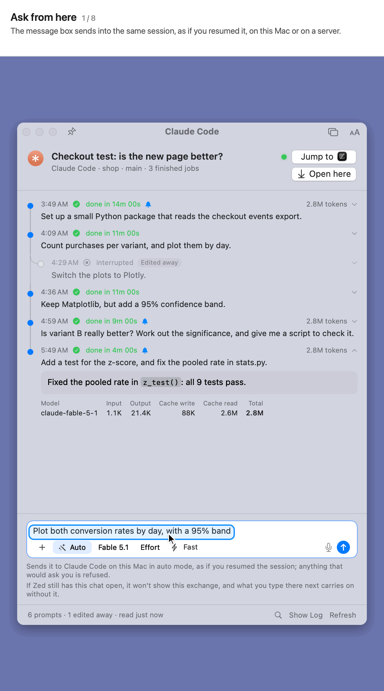

**Included:** selections from Zed, from other apps and copied from VS Code, Accessibility, VS Code's screen reader mode, and the selection shown with its prompt.<br>
**Here we show how to:** send what you've selected with a prompt, and give Agent Buddy permission to read it.

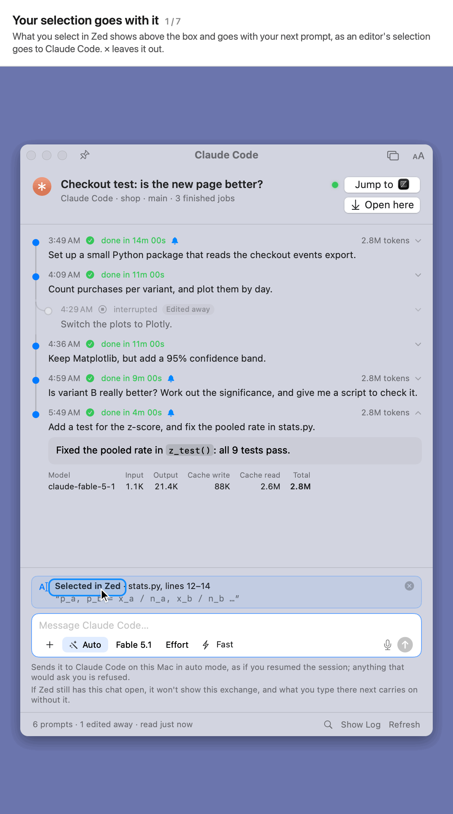

> **Note on selections:** Zed needs no permission. Other apps need **Accessibility** for Agent Buddy: allow it under **System Settings › Privacy & Security › Accessibility**. VS Code also has to be in **Screen Reader Mode** to share what's selected. To turn it on:
>
> 1. Click *VS Code keeps what you select to itself… Switch that on…* under an agent window's message box, or tick **…and in VS Code** under **Settings › General › Selections**.
> 2. Click **Switch On**.
> 3. Close the one-time notice VS Code shows; answering **No** turns it off again.
>
> Chrome keeps its selection to itself: select the text and press **⌘C**, which works in VS Code too.

**Included:** the prompt tree, prompts *Edited away* by a rewind, and prompts *Sent separately*.<br>
**Here we show how to:** find what you asked before rolling back, and open it.

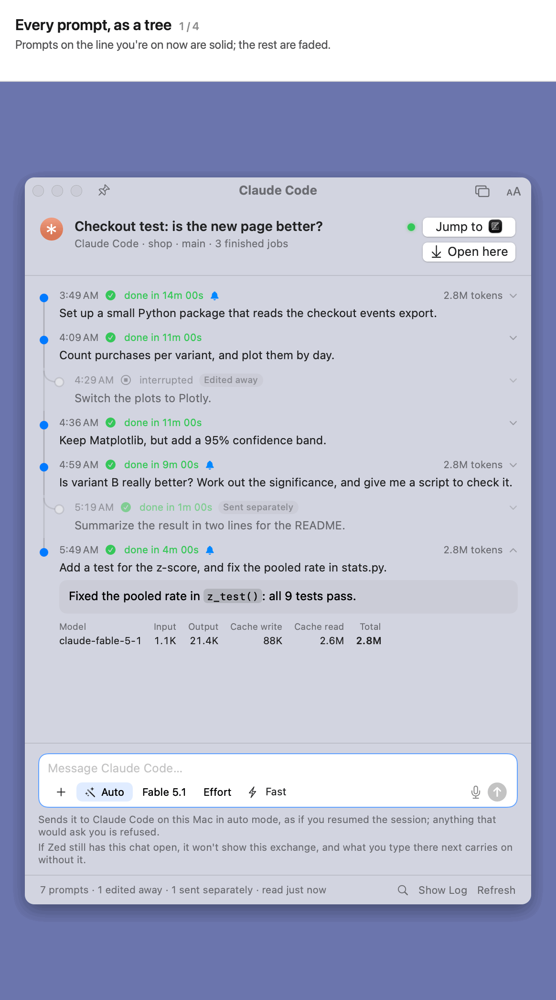

**Included:** search (⌘F) through every prompt and answer, the words marked, and from one to the next.<br>
**Here we show how to:** find what you asked, or were told, before.

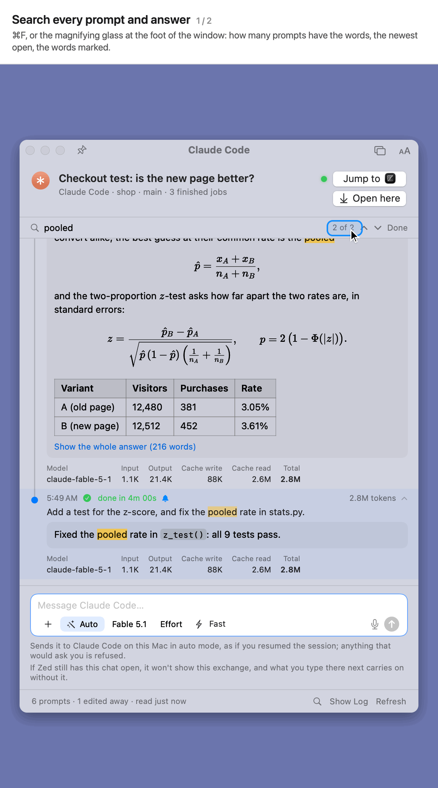

### Token usage summary ([more](docs/tour/3-token-usage/README.md))

**Included:** today, 7 days and 30 days by agent, model and server, day-by-day charts, a table, and tokens by job.<br>
**Here we show how to:** see where your tokens went, and which jobs used the most.

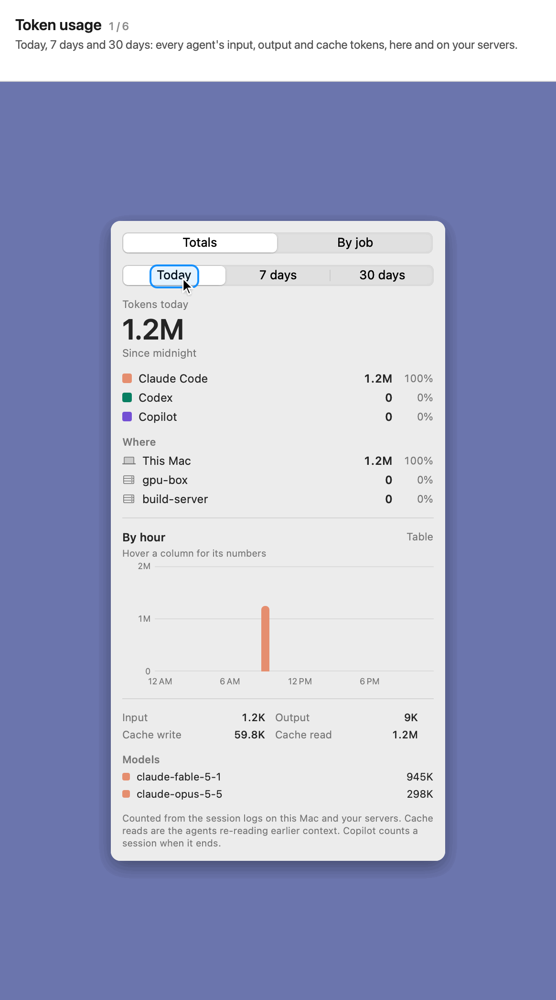

### Settings ([more](docs/tour/4-settings/README.md))

**Included:** Settings › General and Settings › Servers.<br>
**Here we show how to:** choose the agents to track, and follow agents on your servers.

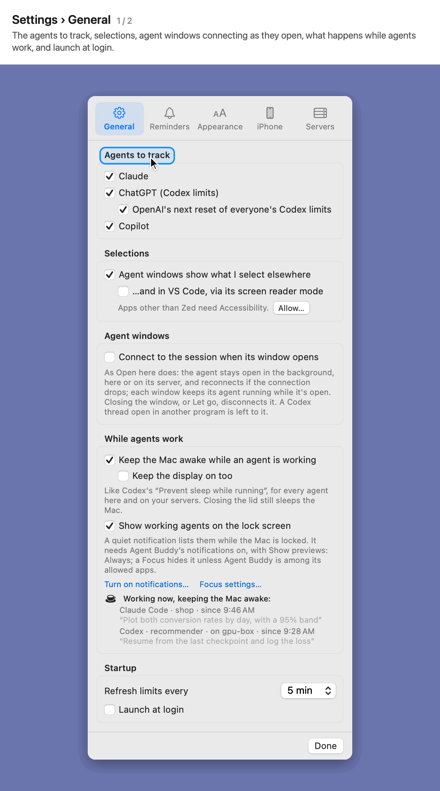

**Included:** keeping the Mac awake while agents work, the lock screen list, and who's working now.<br>
**Here we show how to:** keep long jobs running when you step away.

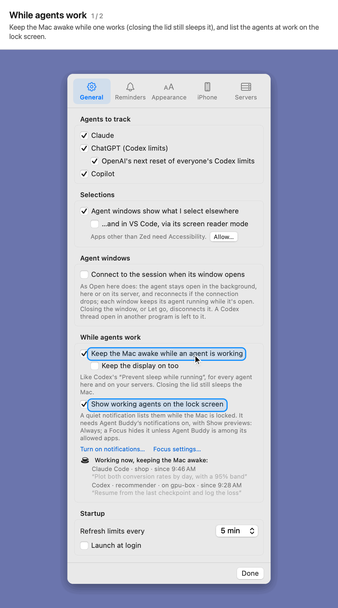

**Included:** Settings › Reminders, and a reminder card.<br>
**Here we show how to:** choose what reminds you, and how.

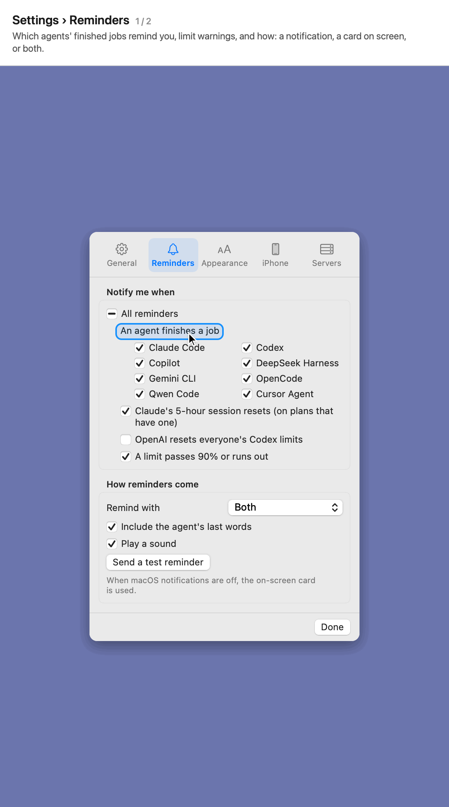

**Included:** light and dark, transparency, agent windows as frosted glass or tabs, and the text's size and typeface, for Agent Buddy and its agent windows.<br>
**Here we show how to:** change how Agent Buddy looks.

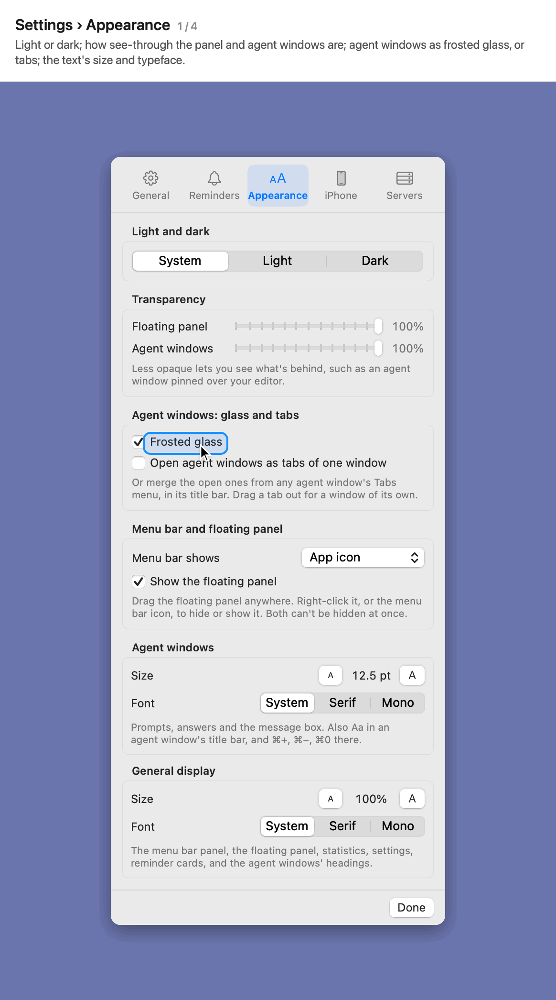


## Agents it supports

| Agent | Plan limits | Job reminders | Agent window | Every step | Ask from the window, Open here | Token usage | On your servers |
| --- | :-: | :-: | :-: | :-: | :-: | :-: | :-: |
| **Claude Code** | ✅ | ✅ | ✅ | ✅ | ✅ | ✅ | ✅ |
| **Codex** (ChatGPT) | ✅ | ✅ | ✅ | ✅ | ✅ | ✅ | ✅ |
| **GitHub Copilot** | ✅ | ✅ | ✅ | ⬜ | ⬜ | ✅ | ✅ |
| **DeepSeek Harness** (`dsh`) | ⬜ | ✅ | ✅ | ⬜ | ⬜ | ✅ | ⬜ |
| **Gemini CLI** | ⬜ | ✅ | ✅ | ⬜ | ⬜ | ✅ | ⬜ |
| **OpenCode** | ⬜ | ✅ | ✅ | ⬜ | ⬜ | ✅ | ⬜ |
| **Qwen Code** | ⬜ | ✅ | ✅ | ⬜ | ⬜ | ✅ | ⬜ |
| **Cursor's agent CLI** | ⬜ | ✅ | ✅ | ⬜ | ⬜ | ✅ | ⬜ |

✅ supported · ⬜ not yet. Plan limits are Claude's week, each model's week (on newer plans such as Ultra, a model's share of the week, such as Fable's *up to 50% of your week*), and its 5-hour session on plans that still have one, with the plan named as Claude names it, and any usage credits in use (from Claude Code's own engine, with a `get_usage` control request), the Codex limits on your ChatGPT plan (from the Codex CLI's `app-server`), and Copilot's premium requests this month (from GitHub's `copilot_internal/user` endpoint, with your GitHub CLI sign-in). The other agents have no plan limits to show; Agent Buddy follows them through their own session logs.

The numbers show in a small floating panel above your windows, on every Space and over full-screen apps. Claude's week shows tagged `wk`, then each model's week by its name, e.g. `CLAUDE wk 38% Fable 22%`, then `GPT 28%` and `COPILOT 27%` (a Claude plan that still has a 5-hour session shows it first, tagged `5h`). Numbers turn orange from 70% and red from 90%.

- **Moving it:** drag it anywhere. It stays on screen, snaps to an edge you drop it near, and remembers its place.
- **Clicking it:** click it for the details. Right-click for Show Details, Hide Floating Panel and Quit.

**Menu bar.** The menu bar shows Agent Buddy's symbol. Click it for the details. Right-click it to hide or show the floating panel, or to quit. In Settings, **Menu bar shows** can switch it to the usage numbers or hide it. The menu bar item and the floating panel can't both be hidden, so Agent Buddy is always reachable. Click the item to see every limit with its reset time, plus your recent jobs.

**Everyone's next Codex reset.** Besides your own weekly limit, OpenAI now and then resets everyone's Codex limits early. When it has announced the next one, Agent Buddy shows when under ChatGPT's limits, with a countdown and what was said; otherwise nothing shows. The data comes from [codex-reset.com](https://codex-reset.com/), a community tracker that isn't OpenAI's. It's asked at most every 10 minutes, and credited where it shows, as the site asks. Turn it off under **Settings › General › Agents to track**; **Settings › Reminders › OpenAI resets everyone's Codex limits** reminds you when one lands (off unless you turn it on).

## Reminders

- **Job finished.** When Claude Code, Codex or Copilot finishes a turn, you get a reminder such as *"Claude Code job finished — Agent usage menu bar app · head_show · took 3m 12s"*, optionally with the agent's last words. Failed turns and turns stopped by a usage limit are reported too; turns you interrupt are not.
- **Claude session reset.** On plans with a 5-hour session, when that window ends, you get *"Claude session reset"* so you know the full limit is back.
- **Limit warnings.** A reminder when any limit passes 90%, and when one runs out.
- **Missed while closed.** A job that finished in the 10 minutes before Agent Buddy started (or while a server was out of reach) is still listed and reminded of, unless Agent Buddy had already seen it before a restart; cleared jobs don't come back.

Reminders arrive as macOS notifications. If notifications are off for Agent Buddy, or if you choose it in Settings, Agent Buddy shows its own card at the top right of the screen instead. They can also go to your iPhone and Apple Watch (under construction, see below).

**One reminder per agent window.** Jobs from the same agent window (one Claude Code session, Codex session or Copilot session, wherever it runs) fold together. When a second job finishes there, its reminder replaces the first one's and says *"Claude Code · 2 jobs finished"*, and Notification Center stacks the window's reminders together.

**Finished-jobs badge.** A blue round number in the floating panel counts the agent windows with finished jobs since you last cleared the list. It also shows in the menu bar when that shows the usage numbers. Click to see them at the top of the popover, one row per window with its number of jobs. Click a row to list its jobs.

- **One window:** swipe it left with two fingers to remove it. You can also right-click it, or click the × that appears when you point at it.
- **All of them:** press **Clear**, and the number disappears.

## While agents work

Under **Settings › General › While agents work**:

- **Keep the Mac awake while an agent is working.** This works like Codex's "Prevent sleep while running", but for every agent Agent Buddy watches, on this Mac and on your servers. While one is in the middle of a job, the Mac doesn't go to sleep on its own. **Keep the display on too** also keeps the screen from dimming to sleep. Closing the lid still puts the Mac to sleep. `pmset -g assertions` shows the hold, naming the agents. Off unless you turn it on.
- **Show working agents on the lock screen.** While the Mac is locked, a quiet notification lists the agents at work, such as "Claude Code · head_show · since 9:40 AM". It changes as agents start and finish, and goes when you unlock. It needs notifications allowed for Agent Buddy. To read it on the lock screen, choose **Show previews: Always** under **System Settings › Notifications › Agent Buddy**. A Focus, such as Work or Do Not Disturb, silences it unless Agent Buddy is one of that Focus's allowed apps (**System Settings › Focus › *the Focus* › Allowed Notifications › Apps**). `"Agent Buddy.app/Contents/MacOS/AgentBuddy" --notification-status` prints what macOS allows. On by default.

An agent counts as working from your prompt until its job ends. A job that goes quiet for 20 minutes stops counting. If the agent's process is still running on this Mac, it keeps counting for up to 3 hours, because a long build or test writes nothing until it's done. The section also lists who's working now.

## Agent windows

Click a reminder to open that agent window's history. This works for the macOS notification, the on-screen card, a row under Finished jobs, and a row under Agent windows. It lists every prompt you asked there, oldest first, as a tree:

- **Each prompt** shows when you asked it, how the turn went ("done in 3m 12s", "interrupted", "stopped with an error", "working"), the tokens its turn used, and its first two lines. A bell marks the turns Agent Buddy reminded you about.
- **Reading:** the latest prompt is open, with the agent's whole answer below it, formatted from its Markdown: formulas (`$…$`, `$$…$$`, `\(…\)`, `\[…\]`) typeset by KaTeX (with dsfont's `\mathds` and bbm's `\mathbbm` too, as in 𝟙 and ℝ), code in boxes with its language and colours, tables, lists and links (which open in your browser). Click any other prompt for all of it, the start of its answer (**Show the whole answer** for the rest), and a table of each model's input, output, cache write and cache read tokens. Click its time line to fold it again. While it's open, select any of its text and press ⌘C to copy it.
- **Every step:** an open prompt shows what the agent did in its turn, each after a ● as its terminal shows it. What it wrote shows whole (black ●). Its actions (green ●) take a line or two: a run of them that went well folds into one line, such as *Read 2 files, ran 3 commands* (click it for each one), and a change shows as *Update(content/sm/07_inverse.tex) ⎿ 1 addition, 1 removal*. Click an action for what it printed. A failed one shows apart, with a red ● and its error in a line. The turn's changes come together at the end under **View changes** (the files and lines changed), each change's diff numbered by the file's lines; a change's **View** opens it there. A change over 10 lines folds until you click **Show N lines**. Claude Code's and Codex's turns show their steps (Codex's code-mode scripts too: the commands they run and the patches they apply), in a session on this Mac or on a server; they're read when you open the prompt, and kept up while it runs. Copilot's turns show the answer.
- **Text size and font:** **Settings › Appearance** has two boxes, each with a size and a typeface (System, Serif or Mono). **Agent windows** sets the prompts, answers and message box in every agent window; **Aa** at the right of an agent window's title bar sets the same, and there ⌘+ and ⌘− change it a point at a time and ⌘0 puts it back. **General display** sets the rest of Agent Buddy, as a percentage from 85% to 150%: the menu bar panel (which widens with it), the floating panel, statistics, settings, reminder cards and the agent windows' headings. Code stays monospaced.
- **Branches:** when you rewind Claude Code to edit an earlier prompt, the prompts you left behind hang off the line, marked "Edited away".
- **Frosted glass:** agent windows are frosted glass: what's behind them shows through, blurred, as in Finder's sidebar, and the message box stays solid. Turn it off under **Settings › Appearance › Agent windows: glass and tabs**; **Transparency** still applies on top.
- **Small windows:** an agent window goes down to 360 × 340. Below about 600 points tall or 520 wide, the header fits in a line, **Jump to** and **Open here** become their icons, the message box grows to three lines at most, and its explanations step aside (its warnings stay), so the prompts keep their room.
- **Keeping up:** while the agent works, the window follows its session's log. A Claude Code log, and the steps of the turn at work, are read on from where the window last stopped, so a long session's log (a hundred megabytes or more) costs no more to follow than a short one's. **Refresh** (⌘R) reads it whole again. A window out of sight (covered by other windows, in the Dock, or with Agent Buddy hidden) reads nothing until it shows again, then catches up; a prompt sent from it is still followed, so you're told when it's done. Many windows open each look at their own moment, so they don't all work at once.

**Agent windows.** The clock button at the top of the popover lists every agent window with finished jobs, by day. They stay there after you clear Finished jobs, for 90 days, so their prompts can still be opened. Swipe one away, or right-click it, to remove it. Windows whose jobs finished before this list existed are read back once from Agent Buddy's log.

**Jump to** (the box with the app's icon, or ⌘J) takes you to where the session runs, if its window is open; a green light before it says it's open there now:

| Where it runs | What Jump does |
| --- | --- |
| Zed, local or over SSH | Focuses the project's window |
| VS Code, Cursor, Windsurf or VSCodium, local or Remote-SSH | Focuses the window with the folder, then opens the conversation for Claude Code's and Codex's extensions |
| The Codex app | Opens the thread |
| Terminal or iTerm2 | Selects the tab; macOS asks once whether Agent Buddy may control them |
| Claude and other apps | Brings the app forward |

Agent Buddy finds the window from the agent's process and from the lists of open windows that VS Code and Zed keep. When the window is closed, Jump says so. The notification's **Jump to Window** button jumps without opening the history.

**Pin** (the pin in the title bar, after the close, minimize and zoom buttons) keeps an agent window above other windows, on every Space and beside full-screen apps, until you unpin it.

**Tabs.** Several agent windows can be one window with tabs, each tab named for its session. Choose **Merge All Agent Windows** from the Tabs menu in a window's title bar (beside **Aa**), or turn on **Open New Agent Windows as Tabs** there or in **Settings › Appearance › Agent windows: glass and tabs**. Drag a tab out, or choose **Move Tab to New Window**, for a window of its own. ⌘⇧] and ⌘⇧[ go to the next and previous tab. Pinning a tab pins the whole window; tabs out of sight don't read their logs until you choose them.

**Search.** ⌘F, or the magnifying glass at the foot of the window, searches every prompt and answer in the session, whatever the case or accents. It says how many prompts have the words, opens the newest of them with its whole answer, and marks the words in the prompt and in the answer. Return or ⌘G goes to the next, ⇧⌘G to the one before, and Esc ends the search.

For a job on a server, Agent Buddy fetches the history over SSH, as it does for the reminders. The script there reads only session logs in the agents' own folders.

**Reply from the window.** Type in the box under the history and press Return to send the agent a prompt (Option-Return starts a new line). It works for Claude Code and Codex sessions, on this Mac and on your servers:

- The agent's own command resumes the session with no window: `claude -p --resume ID` or `codex exec resume ID`, in the session's folder, with its model, and on a server over SSH. The prompt goes in on stdin.
- It keeps the session's permission mode (Claude Code) or sandbox (Codex), but anything that would ask you for permission is refused, as nobody is there to answer. A session that skipped permission checks, or had full access, keeps the checks when sent from here.
- Codex keeps the session's permission profile (`:workspace`), and, if the session lets Codex's own reviewer approve steps beyond its sandbox (`approvals_reviewer = "auto_review"`, as VS Code's Codex can), the reviewer goes on deciding them. On a server whose sandbox can't run commands (Linux `bwrap` without the rights it needs), that's how Codex runs any command or edit, there as in VS Code.
- **The bar under the box**, as an agent's own has it. Each control starts as the session has it, and what you choose holds for what you send from that window:
  - **+** adds files or pictures (or **Paste Image or File** from the clipboard, such as a screenshot copied with ⌃⇧⌘4; or drop files on the box). Codex is given pictures as pictures; anything else is named at the end of the prompt for the agent to open, and Claude Code opens pictures that way too. Into a session kept open here (**Open here**), pictures go with the prompt itself. For a session on a server, the files are copied there first, to `~/.cache/agent-buddy/attachments` (readable only by you, kept a week).
  - **The mode:** for Claude Code, **Auto** (Claude decides what's safe), **Accept edits** or **Plan**; for Codex, **Auto** (it works in the folder, and Codex's own reviewer decides a step beyond it), **Folder only** or **Read only**. Full access is never offered: nobody is there to watch.
  - **The model and effort:** Claude Code's latest Fable, Opus, Sonnet and Haiku, with effort from Low to Max; Codex's models as Codex lists them, where the session runs (`AgentBuddyChecks --codex-models [HOST]` shows them), each with the efforts it has.
  - **Fast:** fast mode, the same model with faster output (it uses more of your plan). Claude Code falls back to standard speed where a model hasn't it; for Codex, it's offered for models with a fast tier.
  - **The microphone** starts macOS's own dictation in the box, as pressing fn twice does (switch Dictation on under System Settings › Keyboard if it asks).
  - **/** at the start of the message lists the agent's commands, as Zed's does: for Claude Code its own that a send can run (`/compact`, `/init`, `/security-review`), yours (`~/.claude/commands`, the folder's `.claude/commands`), your plugins' and your skills; for Codex, your custom prompts (`~/.codex/prompts`, filled in here before sending, as `codex exec` doesn't run them) and its skills (as `$name`). **@** lists the session folder's files and folders (what git tracks and doesn't ignore, or a walk that skips hidden and build folders), best match first, and puts in `@path`. ↑ and ↓ choose, Return or Tab puts one in, Esc closes. For a session on a server, both lists come from the server.
- Your prompt shows at once at the end of the line, marked **Sent from here**, until the session's log has it; then the answer shows as it comes, and the usual reminder comes when it's done. **Stop** ends it. If it couldn't start, its text goes back in the box. While the agent works (on a prompt from here, or one typed elsewhere), keep typing: what you send waits its turn above the box, marked **Queued**, and goes as soon as the answer is done, one after another (× takes one back). Into Codex opened here, it joins the answer under way instead, as typing into Codex while it works does. **Stop** brings what's queued back to the box.
- **Open here:** under **Jump to**, it keeps the session open in Agent Buddy, in the background, with nothing on screen: the agent runs in its own long-running mode (Claude Code reading its prompts as stream-json, Codex's app-server), here or on the server through one SSH connection, and what you send from the box (or from Agent Buddy Remote) goes into it, as if typed there. Nothing is kept until you click it. A Codex thread open in another program is waited for (*Waiting for VS Code to let go*), and taken as soon as it's free; while it's here, that program can't send to it. Or let Agent Buddy take it: when VS Code (or the Codex app, or a Codex terminal) has the thread open, the button reads **Open here from VS Code** (and waiting offers **Take It**). After asking, it stops that program's Codex, which lets go of the thread, and moves the thread here; VS Code starts its Codex again when you next use it there, and its other chats open again. It says first if that Codex is working on another chat at the time, as that work stops too. It only ever stops a Codex program that holds the thread at that moment. **Let go** ends it, and so do closing its window (once an answer under way is done) and quitting Agent Buddy. To have every agent window connect like this as it opens, turn on **Settings › General › Agent windows › Connect to the session when its window opens**: it connects once the window has read the session and nothing is under way, reconnects (every half minute at most) if the connection drops, and leaves a Codex thread another program has open alone. **Let go** keeps that window disconnected until you open it again. On a server, a session whose connection drops without closing (the Mac asleep or offline) ends by itself after 10 minutes without word from Agent Buddy, once no answer is under way.
- **Lights:** **Jump to** (with its app's icon) and **Open here** are two boxes of the same size. A green light before **Jump to** means the session is open in its app (the exact editor window or terminal tab). Once the session is open here, the second box reads **Let go**, and the light before it says how well the agent is reached: green for a session on this Mac; for one on a server, the round trip there (such as *126 ms*, by a ping, or by reaching its SSH port if the server doesn't answer pings), measured every 20 seconds, with fewer and warmer bars the slower it is; or **Disconnected** when Agent Buddy can't reach the server. A red light means it couldn't open here (hover for why).
- Codex lets one program at a time write to a thread. While a Codex thread is open in VS Code's Codex panel, the Codex app or a Codex terminal, the box says where, and **Send** waits: switch that panel to another chat (or close it), and within 20 seconds Send works again. Claude Code has no such lock.
- If the session is still open in Zed, VS Code, a terminal or the Codex app, that window won't show this exchange, and what you type there next carries on without it. So it suits sessions whose window is closed, or a quick reply you don't need to see there. In the history, such a prompt is marked **Sent separately**.
- **Your selection goes with it.** While an agent window is open, text you select elsewhere shows above its box, such as *Selected in Zed · main.rs, lines 10–12*, and goes with your next prompt the way an editor's selection goes to Claude Code (as `<ide_selection>`). The prompt shows it in the window: where it came from under the prompt (*main.rs, lines 10–12*), and, opened, the text itself, as do selections an editor sent with a prompt; search finds words in it too. **×** leaves it out. Text you select in an agent window's answers and steps counts too (*Selected in Claude Code · Fix the login page*): select part of one session's answer, and ask about it there or in another session's window. Formulas go as their TeX, and a change's lines with their − and +. In Zed, Agent Buddy reads what's selected from Zed's own database, with no permission needed; for a project on a server, it reads those lines over SSH, on servers you've enabled. In other apps it uses Accessibility (Safari's and Mail's web pages too): allow Agent Buddy once under **System Settings › Privacy & Security › Accessibility** (the link under the box takes you there). If Agent Buddy is listed there as allowed but the link still shows, the permission is for an earlier build (macOS keeps each build's fingerprint, and switching it off and on doesn't renew it): click the link, and Agent Buddy clears that entry so macOS asks again, or remove it there with **−** and add it again. `open -n -W --stdout /dev/stdout ~/Applications/Agent\ Buddy.app --args --accessibility-status` says whether it's allowed, and what VS Code and Safari show now (how much is selected, never the text). VS Code (and Cursor, Windsurf, VSCodium) tells other apps what's selected only in its screen reader mode. The link under the box, or **…and in VS Code** in Settings, lets Agent Buddy switch that mode on while an agent window is open, the way a screen reader does, and off again when the last one closes or Agent Buddy quits. Meanwhile VS Code shows *Screen Reader Optimized* in its status bar and may play accessibility sounds (`accessibility.signalOptions.volume` turns them down). It also asks once whether you use a screen reader: close that notice, as **No** stops VS Code sharing. Its selection then comes with the file's line numbers, found from the page of the file VS Code shows a screen reader. Chrome doesn't tell at all. In either, or with the VS Code switch off, select and press **⌘C**: the agent window shows *Copied in VS Code · main.rs* until you send it or dismiss it. Copies are only noticed while an agent window is open, and ones a password manager marks secret are skipped. Turn it off under **Settings › General › Selections**. The text stays in memory and goes nowhere but the prompt you send.
- Each send's output is kept for a week in `~/Library/Application Support/AgentBuddy/sends`, or `~/.cache/agent-buddy/sends` on a server. `AgentBuddy --where LOG` shows the command a send would run, without sending.

## iPhone and Apple Watch

> 🚧 **Under construction.** The iPhone and Apple Watch side is still being built. What's below works today, but it may change.

Turn on **Settings › iPhone › Send reminders to my iPhone and Apple Watch**, and every reminder also goes to your iPhone through [ntfy](https://ntfy.sh), a free, open-source notification service. Apple Watch shows the iPhone's alerts.

1. On the iPhone, install **ntfy** from the App Store and allow its notifications.
2. In ntfy, tap **+**, enter the topic Agent Buddy shows (a random name such as `agentbuddy-k3x9…`), and tap **Subscribe**. Then press **Send a test to iPhone** in Agent Buddy.
3. Apple Watch shows ntfy's alerts while the iPhone is locked. If it doesn't, open the Watch app on the iPhone, go to **Notifications**, and turn on ntfy under **Mirror iPhone Alerts**.

**Settings › iPhone** chooses what goes:

- **Send:** always, or only when you're away from this Mac (it's locked, its display sleeps, or you haven't touched it for 3 minutes).
- **Include job names, folders and servers:** on by default. Off, a reminder says only what happened and how long it took.
- **Include the agent's last words:** off by default.

Reminders carry the agent window, so the iPhone and Watch see *"Codex · 3 jobs finished"*, like the Mac. Tapping one opens Agent Buddy Remote if it's installed.

**Privacy.** Messages pass through the ntfy server in readable form, and anyone who knows the topic can read them while the server keeps them (12 hours on ntfy.sh). The topic is a random 22-character name, so it's hard to guess, but it isn't a password. For privacy, [run your own ntfy server](https://docs.ntfy.sh/install/) and enter its address in Settings. If it requires sign-in, enter an access token, which Agent Buddy keeps in your Keychain. For a server of your own to deliver to iPhone at once, set `upstream-base-url: "https://ntfy.sh"` in its configuration; ntfy.sh then only relays a wake-up with the message ID, not the message.

**Limits on ntfy.sh.** The public server takes 250 messages a day from one address. Reminders come first. The status for Agent Buddy Remote goes at most every 15 minutes, only when something changed, and pauses after 200 messages in a day. Settings warns when the day's count nears the limit. A server of your own has no such limit, and Agent Buddy then sends the status up to once a minute.

### Agent Buddy Remote, the companion app

**Agent Buddy Remote** is an app for iPhone and Apple Watch that shows what Agent Buddy on your Mac sees. It isn't in this repository yet: only the Mac side, which publishes for it, is.

- **iPhone:** every limit as a bar with its reset time (Claude's week, then each model's), the finished jobs folded by agent window, and token totals for today, 7 days and 30 days. Swipe a window away to hide it on the phone. Pull to refresh.
- **A job's prompts, and a reply:** tap a finished job (or a reminder in ntfy) for its prompts and whole answers, as the Mac's history window shows them (an open prompt's steps too, folded the same way, fetched from the Mac when you open it), and send its agent a prompt from the box underneath. Sending needs **Let it send prompts** under **Settings › iPhone › Agent Buddy Remote**, off until you turn it on; the Mac then says on screen when a prompt came from the phone.
- **Token usage:** the Mac's Token usage page on the phone: Today, 7 days or 30 days; the chart and totals, or each job's tokens.
- **Apple Watch:** a ring for each agent's main limits (Claude: its week), the finished jobs and today's tokens.

It reads the status Agent Buddy publishes on a second topic (`<topic>-status`, which the ntfy app doesn't subscribe to, so it never rings) and the reminders sent since. Pair it by scanning the code under **Settings › iPhone › Set up** with the iPhone's Camera. Apple Watch gets the pairing from the iPhone.

For a job's prompts, token usage and prompts to send, the phone asks the Mac through the same server (`<topic>-ask` and `<topic>-answer`). Requests and replies are sealed with a key only the Mac and the phone that scanned the code have, so the server can't read them and nobody else can send them. Under **Settings › iPhone › Agent Buddy Remote**, **Share usage with Agent Buddy Remote** (on) gives it the status, and **Let it open jobs and statistics** (on) and **Let it send prompts** (off) say what the phone may ask; **Make a new code**, under the code, gives a new key. Each request and reply counts as a message on ntfy.sh.

Instant alerts still come from the ntfy app: without a paid Apple Developer Program membership, an app you build yourself can't receive push notifications.

## Token statistics

Click the chart button at the top of the popover to see how many tokens your agents used. Choose **Today**, **7 days** or **30 days**.

- **Total:** the period's total, with an average per day for 7 and 30 days.
- **Agents:** each agent's tokens and share.
- **Columns:** hourly for today, daily for 7 and 30 days, stacked by agent. Point at a column for its numbers, or press **Table** to see every hour or day as rows.
- **Kinds:** input, output, cache writes and cache reads. Cache reads are usually most of it: the agents re-reading earlier context.
- **Models:** the models that used the most.

**By job** lists each job of the period, newest first or by most tokens: the prompt, where and when it ran, its models and its tokens. A job is one prompt and the agent's work on it. Claude Code's and Codex's sub-agents count in the job that started them. Click a job for each model's input, output, cache write and cache read, and a link to the prompt in its window. The numbers are counted the same way as the totals, and they match them exactly. Copilot reports tokens per session, not per job, so its rows are whole sessions. Jobs on your servers are read over SSH, at most every 10 minutes while the page is open.

The counts come from the session logs on your Mac:

- **Claude Code:** each message's usage, counted once even when a session is forked.
- **Codex:** each model response's usage record.
- **Copilot:** each session's totals, counted when the session ends.

The first count reads the last 35 days, which took about a second for 200 MB of logs. After that, a cache in `~/Library/Application Support/AgentBuddy` means only new log lines are read.

### Servers you work on over SSH

When you run Claude Code or Codex in a remote terminal (VS Code Remote-SSH, Zed remote, or plain ssh), their logs stay on the server. Tick the server under **Settings › Servers** and Agent Buddy covers it like your Mac:

- **Finished jobs remind you.** Agent Buddy keeps one SSH connection open to the server. A small watcher there follows the agents' session logs and streams a slimmed copy of each new line: only the fields that show a turn finished, with text cut to 400 characters. The lines go through the same trackers as your Mac's, so a job finishing on the server gets the same reminder, card and badge, marked "on <server>". If the connection drops, Agent Buddy reconnects after 5, 10, 20, 40, then every 60 seconds.
- **Tokens count.** A small counter runs on the server and brings back only token counts. Each later count reads only new log lines. The Statistics page shows how much was used on this Mac and on each server.

Agent Buddy suggests the hosts from `~/.ssh/config`, Zed's SSH connections and VS Code's Remote-SSH settings, and you can add any `user@server`.

- **Sign-in:** it uses `ssh -o BatchMode=yes`, which never asks for a password, so the server must accept your SSH key, as it does for VS Code and Zed.
- **Requirements:** the server needs Python 3.6 or later. Nothing is installed or left on it, and the watcher exits when Agent Buddy disconnects.
- **Offline servers:** a server that can't be reached keeps showing its last counts, with the reason. Settings shows whether each server is connected ("Watching") or reconnecting, and why.

Your plan limits already include remote use, since they come from your accounts and not from the logs. A server's Codex may be signed in to another ChatGPT account, so its rate-limit snapshots don't change the ChatGPT percentages shown.

## Build and install

Requires macOS 13 or later and Swift 5.9 or later (the Xcode Command Line Tools are enough).

```bash
scripts/build-app.sh              # builds build/Agent Buddy.app
scripts/build-app.sh --install    # also copies it to ~/Applications and starts it
scripts/build-app.sh --universal  # for Apple silicon and Intel Macs both
scripts/make-dmg.sh               # build/AgentBuddy-<version>.dmg, a disk image to install from
```

**From the disk image.** Open `AgentBuddy-<version>.dmg` and drag **Agent Buddy** onto **Applications**. It runs on Apple silicon and Intel Macs with macOS 13 or later. The app is signed with your Apple Development certificate when you have one (so macOS keeps the permissions you give it across updates), else ad hoc; either way not with a Developer ID that Apple has notarized, so a Mac that downloaded the image blocks the first open. On macOS 15 or later, open Agent Buddy once, click **Done**, then go to **System Settings › Privacy & Security** and click **Open Anyway** (right-click › Open no longer gets past this). On macOS 13 or 14, right-click Agent Buddy in Applications, choose **Open**, then **Open** again. On the Mac that built it, it opens as is. To update, quit Agent Buddy from its menu, then drag the new one over the old.

The first time it starts, macOS asks whether Agent Buddy may send notifications. Choose **Allow**. If you missed it, turn it on in **System Settings › Notifications › Agent Buddy**.

To start Agent Buddy when you log in, tick **Launch at login** in its Settings.

**It used to be called HeadShow.** On its first launch, Agent Buddy takes over what HeadShow kept: its settings, finished jobs, agent windows, token count caches and log. Installing quits and removes `HeadShow.app`, so reminders don't come twice. macOS treats Agent Buddy as a new app, so it asks again about notifications. If HeadShow was set to launch at login, tick **Launch at login** again in Agent Buddy.

## How it works

Nothing leaves your Mac except the usage requests each vendor's own tools already make, the codex-reset.com forecast (unless you turn it off), and, only if you turn it on, the reminders and status sent to the ntfy server you choose for your iPhone. Opening a server job's history runs one short script over SSH that sends back that session's prompts (cut short) and answers. Sending a prompt from a window runs the agent's own command, on the server over SSH for a server's session.

- **Claude:** starts `claude -p` in stream-json mode with hooks and MCP servers disabled and no session saved, asks `get_usage`, then stops it. No message is sent to a model. Your Claude Code sign-in is used as is.
- **ChatGPT (Codex):** starts `codex app-server` (your installed Codex CLI, or the one inside ChatGPT.app), asks for rate limits, then stops it. If that fails, it uses the latest rate-limit snapshot in `~/.codex/sessions`.
- **Copilot:** gets your token from `gh auth token` (or gh's keychain item or `hosts.yml`) and sends it only to `api.github.com`. The token is never stored.
- **Answers:** drawn by WebKit from files bundled with the app (KaTeX 0.19.1, marked 18.1.1 and highlight.js 11.12.0, with their licences, in `Companion/AgentBuddyRemoteKit/Sources/AgentBuddyMarkdown/Web`). Nothing is fetched to show them, and an answer's own HTML is shown as text, never run.
- **Everyone's Codex resets:** `GET https://codex-reset.com/api/forecast`, naming Agent Buddy in its User-Agent and sending nothing about you, at most every 10 minutes.
- **Finished jobs:** watches the agents' session logs with FSEvents and reads only the new lines:
  - Claude Code: `~/.claude/projects/<project>/<session>.jsonl` (assistant `stop_reason: end_turn`, or the stop-hook summary)
  - Codex: `~/.codex/sessions/**/rollout-*.jsonl` (`task_complete`)
  - Copilot: `~/.copilot/session-state/<session>/events.jsonl` (the `agentStop` record), written by the Copilot CLI and by VS Code's Copilot agent host
- **The other agents:** a session is read whole when its log changes (a second and a half after it settles), and its turns compared with the last read: a turn that has just ended reminds (not one you stopped), one under way counts as working.
  - DeepSeek Harness: `~/.dsh/sessions/--<folder>--/<session>/session.vN.jsonl.zstd` (`$DSH_HOME` moves it): events, a turn closed by `turn/end`. Harness compresses its logs with Zstandard, which macOS can't read itself: Agent Buddy undoes it with Node, which Harness runs on (22.15 or later).
  - Gemini CLI: `~/.gemini/tmp/<project>/chats/session-*.json` (and `.jsonl` in newer versions, with their patches and rewinds); a turn ends with a reply that calls no more tools. The project's folder comes from `~/.gemini/projects.json`.
  - OpenCode: its database, `~/.local/share/opencode/opencode.db` (read, never written): a turn ends with a reply that stopped rather than called tools.
  - Qwen Code: `~/.qwen/projects/<project>/chats/<session>.jsonl`, a turn closed by its `turn_result` record.
  - Cursor's agent CLI: `~/.cursor/chats/<workspace>/<chat>/store.db`. Its layout is unpublished, so it's read as best it can be: its messages and its name. It keeps no times or tokens per message, so a chat's last change dates its last answer, and its tokens don't count.

Limits refresh every 5 minutes (adjustable), when you open the popover, and a few seconds after a job finishes. Agent Buddy changes no agent's settings and installs no hooks.

## Settings

Open the popover and click the gear. Settings has five tabs, each in boxes:

- **General:** **Agents to track**; **Selections** (what you select elsewhere showing in agent windows, and VS Code's screen reader mode); **Agent windows** (connecting to the session when its window opens); **While agents work** (keeping the Mac awake, and the lock screen's list of agents at work); **Startup** (how often limits refresh, and Launch at login)
- **Reminders:** **Notify me when** (**All reminders** turns every one on, or all of them off; **An agent finishes a job** has each of the eight agents), and **How reminders come**: macOS notification, on-screen card or both, with the agent's last words and a sound, and a test
- **Appearance:** **Light and dark** (System, Light or Dark, for all of Agent Buddy's windows and panels); **Transparency** (how see-through the floating panel and the agent windows are, down to 40%, so a pinned agent window shows your editor behind it); what the **menu bar** shows (the app icon, the usage numbers, or nothing) and the **floating panel**; agent windows as **frosted glass**, and opened as **tabs** of one window; the text size and typeface for **agent windows** and for the rest of Agent Buddy (**General display**)
- **iPhone:** **Reminders on iPhone and Apple Watch** through ntfy (the server, topic and access token, when to send, what reminders may say, and a test); **Agent Buddy Remote** (what the companion app may see and do); **Set up** (the steps, and the pairing code)
- **Servers:** the servers whose agents Agent Buddy watches over SSH

## Checks

XCTest isn't part of the Command Line Tools, so the checks are a small program:

```bash
swift run AgentBuddyChecks                  # parsers, trackers and a real FSEvents watcher test
swift run AgentBuddyChecks --live           # read your real Claude, ChatGPT and Copilot limits
swift run AgentBuddyChecks --stats          # count your real token usage for today, 7 and 30 days
swift run AgentBuddyChecks --remote HOST    # count a server's token usage over ssh
swift run AgentBuddyChecks --parity         # check the server counter against the Mac's on this Mac's logs
swift run AgentBuddyChecks --slim-parity FILE...   # check that slimmed lines find the same finished jobs
swift run AgentBuddyChecks --replay <file>  # run a real session log through its tracker
swift run AgentBuddyChecks --history <file> # print a session log's prompt tree, with each prompt's tokens
swift run -c release AgentBuddyChecks --time-history <file>      # how long reading a Claude Code log takes, step by step
swift run -c release AgentBuddyChecks --reading-parity <file>... # grow copies of logs in pieces; reading on must match reading whole
swift run AgentBuddyChecks --job-parity <file>...   # check each job's tokens against the totals
swift run AgentBuddyChecks --codex-resets  # ask codex-reset.com once for everyone's Codex resets
swift run AgentBuddyChecks --zed-selection # what Zed's database says is selected now (where, not the text)
```

Two more flags help with troubleshooting:

```bash
"$HOME/Applications/Agent Buddy.app/Contents/MacOS/AgentBuddy" --notification-status   # allowed or denied?
.build/debug/AgentBuddy --snapshot /tmp/agentbuddy                            # render the UI to PNGs
.build/debug/AgentBuddy --tour docs/tour                                      # redraw the tour's GIFs, from sample data only
.build/debug/AgentBuddy --selftest-panel                                      # drag, drop and click a real floating panel
swift run AgentBuddyChecks --watch 60                                         # print what the watcher sees for a minute
.build/debug/AgentBuddy --where <session log> [--on SERVER]                   # where a session runs, what Jump would do and what a send would run
.build/debug/AgentBuddy --selftest-history <session log>                      # open its history window off screen and check it
.build/release/AgentBuddy --probe-window [--app] [SECONDS] <session log>...  # an agent window per log (on copies): CPU each second, memory and GPU, sitting, waiting, streaming, mostly out of sight
.build/debug/AgentBuddy --selftest-markdown [PNG]                             # draw a sample answer (formulas, code, a table) and check it
.build/debug/AgentBuddy --working                                           # the agents working now, and what keeping awake would hold
.build/debug/AgentBuddy --selftest-awake                                    # hold and release "keep awake", checked in macOS's power assertions
```

If a finished job doesn't show up, look in `~/Library/Logs/AgentBuddy/agentbuddy.log`. It records each session the watcher opens, each finished turn and whether it reminded. To log every file read as well, turn on the debug setting and restart Agent Buddy:

```bash
defaults write io.github.homoy.agentbuddy debugWatcher -bool YES   # and -bool NO to turn it off
```

## Project layout

```
Sources/AgentBuddyCore/        quota readers, session trackers, FSEvents watcher (no UI)
Sources/AgentBuddy/            the menu bar app (AppKit + SwiftUI)
Sources/AgentBuddyChecks/      self-checks
Support/                       Info.plist and the app icon
Companion/AgentBuddyRemoteKit/ shared Swift package: the status format, the ntfy client, the answer renderer
scripts/                       build-app.sh, make-dmg.sh, make-icon.swift
```

## License

Copyright 2026 Haomu Yuan. Licensed under the [Apache License, Version 2.0](LICENSE).

The answer renderer bundles KaTeX and marked (MIT) and highlight.js (BSD-3-Clause), each under its own licence, in `Companion/AgentBuddyRemoteKit/Sources/AgentBuddyMarkdown/Web`.
