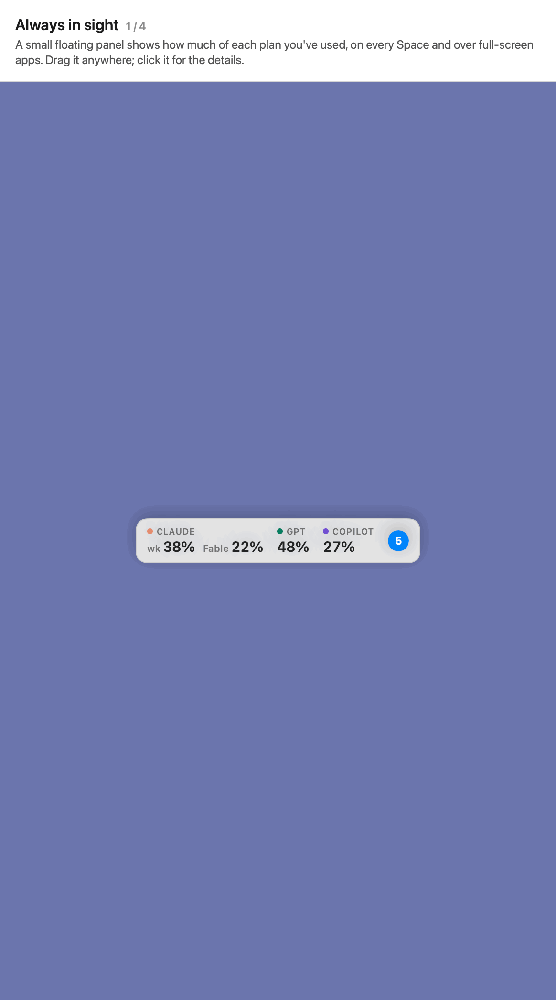

# How much token is left, and when it resets

**Included:** the floating panel, every limit with its reset time, everyone's next Codex reset, and finished jobs. 
**Here we show how to:** read your limits at a glance, open the details, and find the jobs that finished.

1. **The floating panel** shows how much of each plan you've used, on every Space and over full-screen apps: Claude's week (`wk`) and each model's week (such as `Fable`), and its 5-hour session (`5h`) on plans that still have one, ChatGPT's Codex limits and Copilot's requests. Numbers turn orange from 70% and red from 90%. Drag it anywhere; it snaps to an edge you drop it near.
2. **Click it** (or the menu bar icon) for every limit, how much is used, and when each one resets, such as *Resets in 2h 14m · 4:59 PM*. On plans with a 5-hour session, when Claude's session resets, a reminder tells you the whole limit is back.
3. **Everyone's next Codex reset.** When OpenAI announces that it'll reset everyone's Codex limits early, a countdown shows under ChatGPT, from [codex-reset.com](https://codex-reset.com/).
4. **Finished jobs** sit at the top, folded by agent window. The blue number counts the windows with finished jobs. Click one to open its [agent window](../2-agent-windows/README.md).
