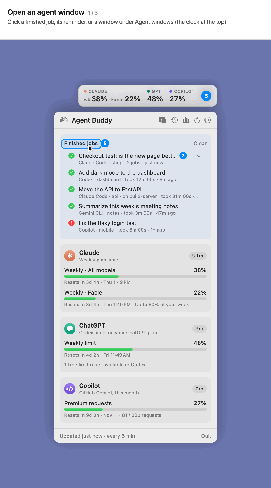
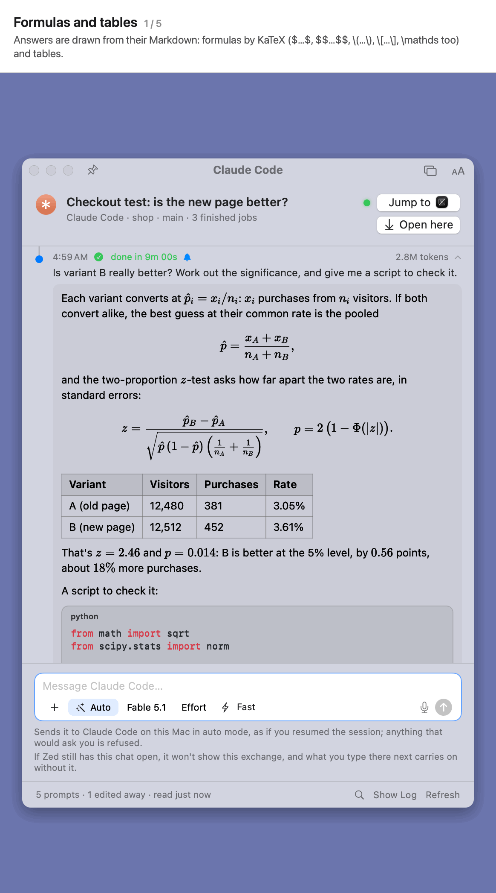
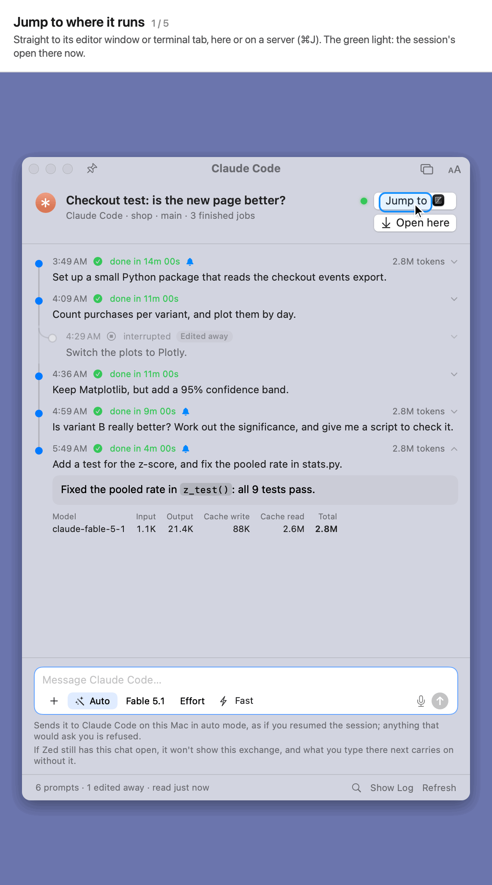
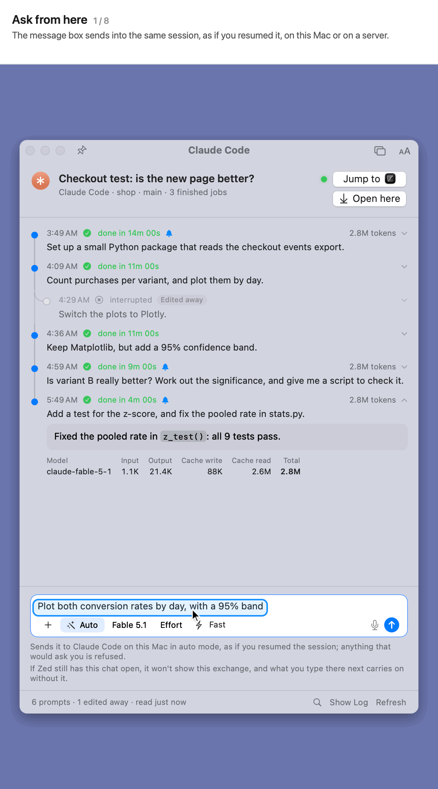
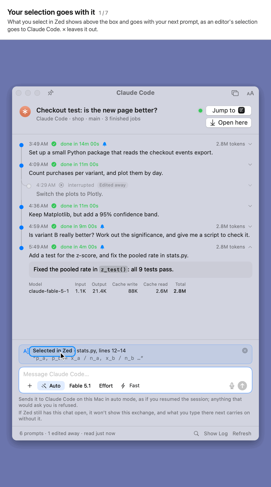
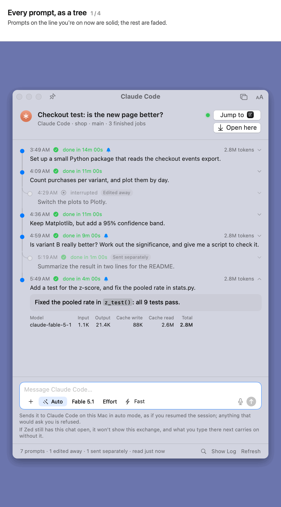
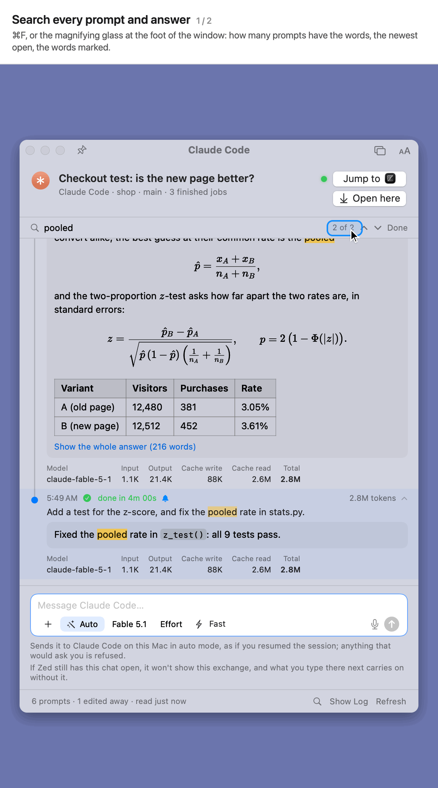

# Agent windows

An agent window shows one session of Claude Code, Codex, Copilot or another agent: every prompt you asked there, what the agent did, and a message box to ask more. It works the same for a session on this Mac or on one of your servers.

## Opening one

**Included:** the list of agent windows, and a window's prompts, answers and tokens. 
**Here we show how to:** open an agent window from a finished job or the list.

Click a finished job in the popover, its reminder, or a window under **Agent windows** (the clock at the top of the popover). Windows stay in that list for 90 days.

Several agent windows can be one window with tabs: choose **Merge All Agent Windows** from the Tabs menu in a window's title bar, or turn on **Open New Agent Windows as Tabs**. Drag a tab out, or choose **Move Tab to New Window**, to separate it. ⌘⇧] and ⌘⇧[ switch tabs.

## Answers: formulas, code, steps and changes

**Included:** formulas (KaTeX), tables, code boxes, every step the agent took, and the change summary. 
**Here we show how to:** read an answer, open a step for what it printed, and see every change the agent made.

- Answers are drawn from their Markdown. Formulas (`$…$`, `$$…$$`, `\(…\)`, `\[…\]`, and `\mathds`) are typeset by KaTeX. Tables, lists and links work too.
- Code shows in boxes, coloured for its language. Select any text and press ⌘C to copy it, as Markdown.
- **Search** (⌘F, or the magnifying glass at the foot of the window) finds words in every prompt and answer of the session and marks them. Return or ⌘G goes to the next prompt that has them, ⇧⌘G to the one before.
- **Every step** the agent took shows after a ●, as its terminal shows it. Actions that went well fold into one line, such as *Read 1 file, searched for 1 pattern*; a failed one shows apart. Click a line to open it.
- **View changes** lists every file the agent changed, each change's lines numbered as in the file. A change's **View** jumps there.

## Jump to and Open here, their lights, and tabs

**Included:** Jump to and Open here with their lights, a server's signal, Let go, and windows as tabs. 
**Here we show how to:** go straight to where a session runs, open it in Agent Buddy, see how well it's reached, and keep several windows as tabs.

- **Jump to** takes you straight to where the session runs (⌘J): its window in VS Code, Cursor or Zed, or its tab in Terminal or iTerm2, here or on a server.
- **Open here** opens the session in Agent Buddy, in the background. What you send from the box goes into it, as if typed there. **Let go** gives it back, and so do closing the window (once an answer under way is done) and quitting Agent Buddy. Codex lets one program at a time write to a thread, so Agent Buddy asks first before taking one over. **Settings › General › Agent windows** can have every window open here as it opens.
- **Jump to** (with its app's icon) and **Open here** are two boxes of the same size. A green light before **Jump to** means the session is open in its app (the exact editor window or terminal tab). Once the session is open here, the second box reads **Let go**, and the light before it says how well the agent is reached: green for a session on this Mac; for one on a server, the round trip there (such as *126 ms*, by a ping, or by reaching its SSH port if the server doesn't answer pings), measured every 20 seconds, with fewer and warmer bars the slower it is; or **Disconnected** when Agent Buddy can't reach the server. A red light means it couldn't open here (hover for why).
- **Tabs:** several agent windows can be one window with tabs, each named for its session: **Merge All Agent Windows** from the Tabs menu in a window's title bar, or **Open New Agent Windows as Tabs**. Drag a tab out, or **Move Tab to New Window**, to separate it; ⌘⇧] and ⌘⇧[ switch tabs.

## The message box

**Included:** the message box, with + for files, the mode, model, effort and fast mode, `@` for files, `/` for commands, dictation, Stop, and sending while it works (**Queued**). 
**Here we show how to:** ask the agent from the window, as you would in its own.

- The box sends into the same session, as if you resumed it.
- **+** adds files or photos. You can also paste a screenshot or drop files on the box.
- The bar sets the **mode** (Auto, Accept edits or Plan), the **model**, the **effort** and **fast mode**, as the agent has them. Each starts as the session has it.
- Type **@** and part of a name to add one of the session's files or folders, as in Zed. Type **/** for the agent's commands, your own commands and skills.
- The **microphone** dictates into the box, as pressing fn twice does.
- Your prompt shows at once; then its steps and answer as they come, and the usual reminder when it's done. **Stop** ends it.
- While it works, keep typing: what you send waits its turn above the box (**Queued**, × takes it back) and goes as soon as the answer is done. Into Codex opened here, it joins the answer under way instead. **Stop** brings what's queued back to the box.

## Selections, and giving permission

**Included:** selections from Zed, from other apps and copied from VS Code, Accessibility, VS Code's screen reader mode, and the selection shown with its prompt. 
**Here we show how to:** send what you've selected with a prompt, and give Agent Buddy permission to read it.

What you select in another app shows above the box, and goes with your next prompt, the way an editor's selection goes to Claude Code. **×** leaves it out. The prompt then shows it in the window: where it came from under the prompt, and, opened, the text itself (selections an editor sent with a prompt show the same way). Search finds words in it too.

- **Zed** needs no permission. Agent Buddy reads the selection from Zed's own database.
- **Other apps** need Accessibility. Click *For other apps too, allow Accessibility…* under the box, then switch Agent Buddy on under **System Settings › Privacy & Security › Accessibility**.
- **VS Code** (and Cursor, Windsurf, VSCodium) shares what's selected only in its screen reader mode:
  1. Allow Accessibility as above.
  2. Click *VS Code keeps what you select to itself… Switch that on…* under the box (or tick **…and in VS Code** under **Settings › General › Selections**).
  3. Click **Switch On** when Agent Buddy asks.
  4. VS Code then asks once whether you use a screen reader. Close that notice; **No** stops it sharing.

  VS Code shows *Screen Reader Optimized* while an agent window is open, and goes back to normal when the last one closes.
- Or select the text in VS Code or Chrome and press **⌘C**. It shows above the box until you send it or dismiss it.
- Turn selections off under **Settings › General › Selections**.

## A clean tree, for rolling back

**Included:** the prompt tree, prompts *Edited away* by a rewind, and prompts *Sent separately*. 
**Here we show how to:** find what you asked before rolling back, and open it.

Every prompt shows as a tree. The line you're on now is solid. When you rewind Claude Code to edit an earlier prompt, the prompts you left behind hang off the line, marked **Edited away**. Click any of them for what was asked and answered. A prompt sent on its own (as the message box does with `claude -p`) is marked **Sent separately**.

## Search

**Included:** search (⌘F) through every prompt and answer, the words marked, and from one to the next. 
**Here we show how to:** find what you asked, or were told, before.

- **⌘F**, or the magnifying glass at the foot of the window, searches every prompt and answer in the session (and the selections sent with them), whatever the case or accents.
- It says how many prompts have the words, opens the newest with its whole answer, and marks the words in the prompt and in the answer.
- Return or ⌘G goes to the next, ⇧⌘G to the one before; Esc ends the search.

## Frosted glass, and small windows

- Agent windows are frosted glass: what's behind them shows through, blurred, and the message box stays solid. Turn it off under **Settings › Appearance › Agent windows: glass and tabs**.
- An agent window goes down to 360 × 340. Small, its header fits in a line and **Jump to** and **Open here** become their icons, so the prompts keep their room.
