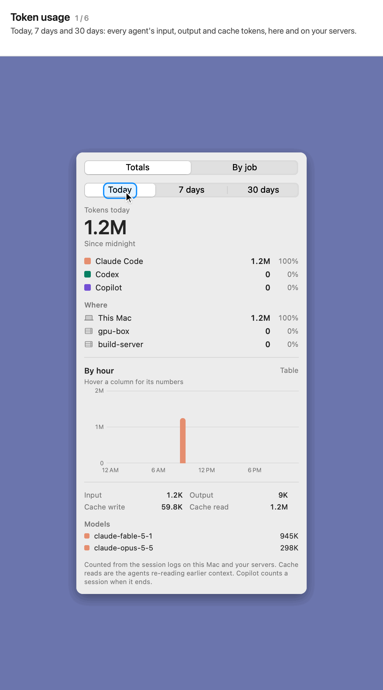

# Token usage

**Included:** today, 7 days and 30 days by agent, model and server, day-by-day charts, a table, and tokens by job. 
**Here we show how to:** see where your tokens went, and which jobs used the most.

Click the chart button at the top of the popover.

- **Totals:** today, 7 days or 30 days. Every agent's input, output, cache-write and cache-read tokens, counted from the session logs on this Mac and on your servers, with where they were used.
- **Day by day:** each agent in its own colour. Point at a day for its numbers, or switch to a **table** to compare models.
- **By job:** each job of the period with its tokens, newest first or most first. Open one for each model's tokens and a link to its prompt.
