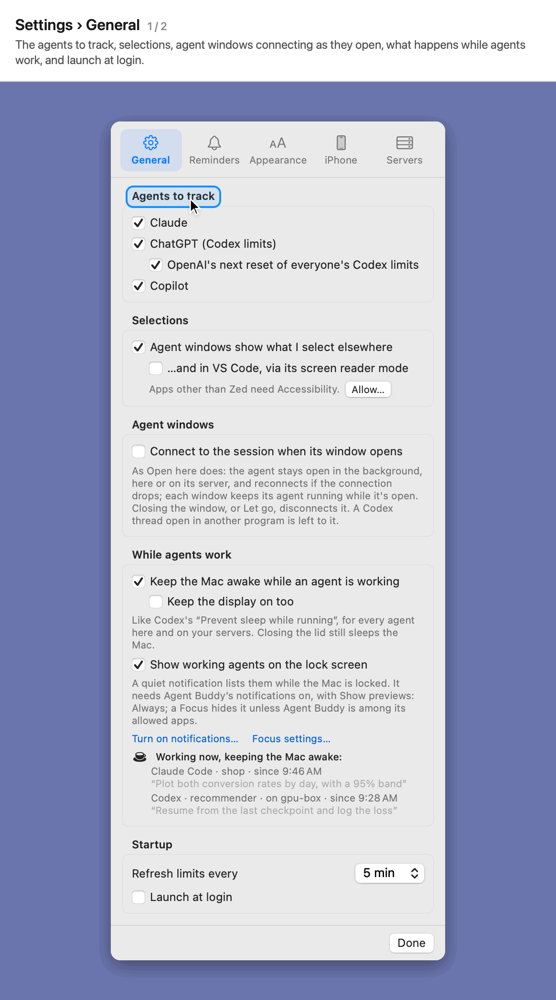
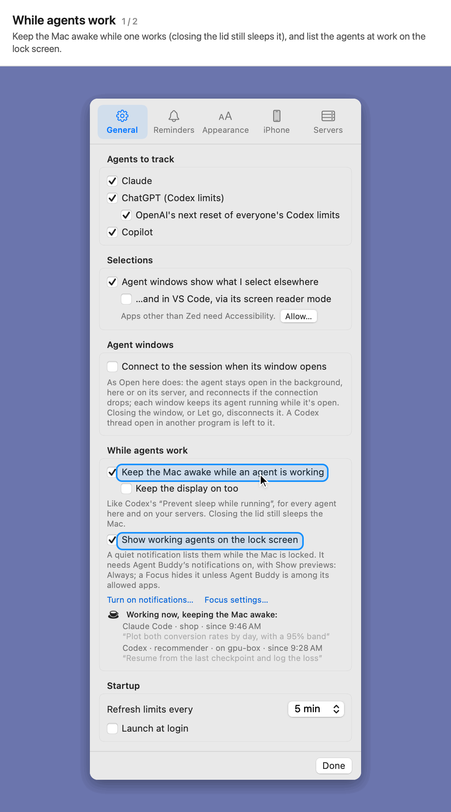
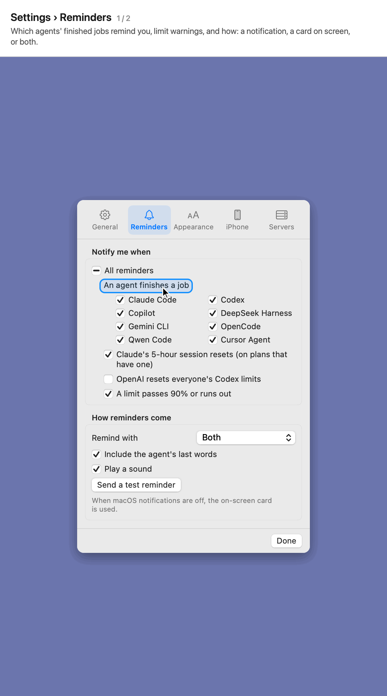
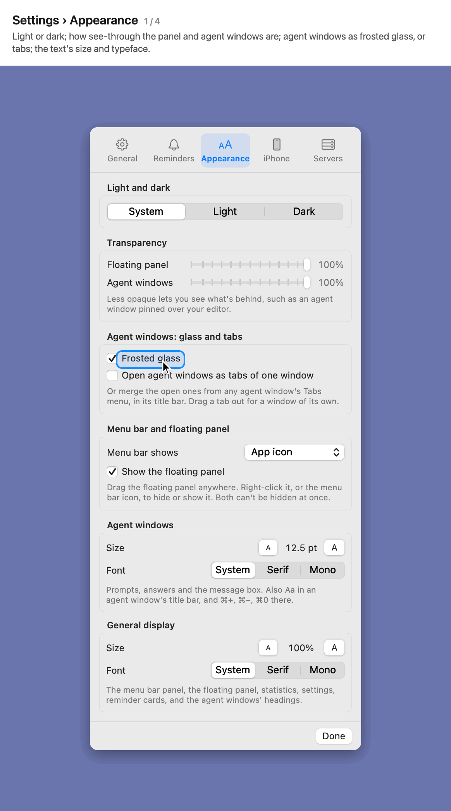
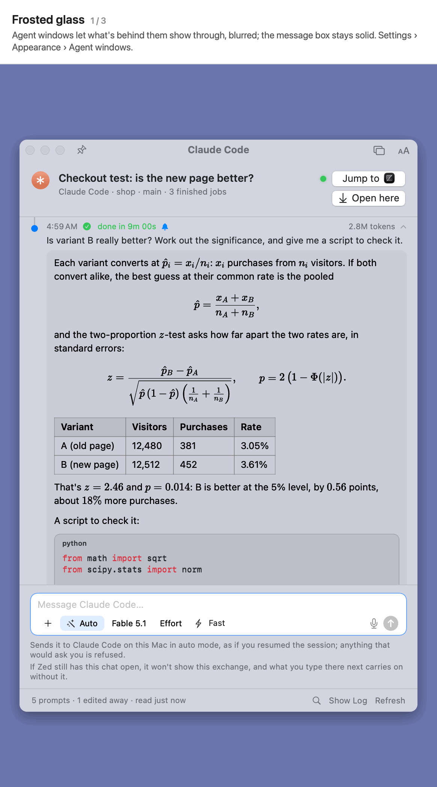

# Settings

Click the gear at the top of the popover.

## General and servers

**Included:** Settings › General and Settings › Servers. 
**Here we show how to:** choose the agents to track, and follow agents on your servers.

- **General:** the agents to track, selections, agent windows opening their session here as they open, what happens while agents work, how often limits refresh, and launch at login.
- **Servers:** agents on your servers, followed over SSH with your key. Their finished jobs remind you, their windows open, Jump finds them and their tokens count. Tick a server Agent Buddy suggests (from your SSH config, Zed and VS Code), or type `user@server` and click **Add**.

## While agents work

**Included:** keeping the Mac awake while agents work, the lock screen list, and who's working now. 
**Here we show how to:** keep long jobs running when you step away.

- **Keep the Mac awake while an agent is working**, here or on a server, and optionally the display too. Closing the lid still sleeps the Mac.
- **Show working agents on the lock screen** as a quiet notification while the Mac is locked.
- **Working now** lists the agents at work. The Mac sleeps again when they're done.

## Reminders

**Included:** Settings › Reminders, and a reminder card. 
**Here we show how to:** choose what reminds you, and how.

- Choose which agents' finished jobs remind you, Claude's 5-hour session reset (on plans that have one), OpenAI resetting everyone's Codex limits, and warnings when a limit passes 90% or runs out.
- Remind with a macOS notification, a card on screen, or both, optionally with the agent's last words and a sound. **Send a test reminder** shows how one looks.
- Click a reminder to open its agent window, or Jump straight to where it runs.

## Appearance

**Included:** light and dark, transparency, agent windows as frosted glass or tabs, and the text's size and typeface. 
**Here we show how to:** change how Agent Buddy looks.

- **Light and dark:** System, Light or Dark, for all of Agent Buddy.
- **Transparency:** how see-through the floating panel and agent windows are.
- **Agent windows: glass and tabs:** frosted glass (what's behind an agent window shows through, blurred; on unless you turn it off), and new agent windows opened as tabs of one window.
- **General display:** the size (85% to 150%) and typeface (System, Serif or Mono) of the popover, floating panel, statistics, settings and reminder cards.

**Included:** agent windows as frosted glass, in dark, and in their own text size and typeface. 
**Here we show how to:** make agent windows easier to read.

- **Agent windows** follow the same light or dark, with a text size and typeface of their own for prompts, answers and the message box. Set them with **Aa** in a window's title bar, ⌘+ and ⌘−, or **Settings › Appearance › Agent windows**.
